<picture>
  <source media="(prefers-color-scheme: dark)" srcset="assets/cover-dark.svg">
  <source media="(prefers-color-scheme: light)" srcset="assets/cover-light.svg">
  
</picture>

Master’s student in Big Data Analytics, I focus on building AI/ML systems that address real business problems. I am looking for an opportunity to apply these skills on high-impact projects and sharpen them against real-world constraints.

<picture>
  <source media="(prefers-color-scheme: dark)" srcset="assets/toolkit-dark.svg">
  <source media="(prefers-color-scheme: light)" srcset="assets/toolkit-light.svg">
  
</picture>

<b>2026</b> · 200 contributions

<picture>
  <source media="(prefers-color-scheme: dark)" srcset="assets/contributions-2026-dark.svg">
  <source media="(prefers-color-scheme: light)" srcset="assets/contributions-2026-light.svg">
  
</picture>

<b>2025</b> · 0 contributions

<picture>
  <source media="(prefers-color-scheme: dark)" srcset="assets/contributions-2025-dark.svg">
  <source media="(prefers-color-scheme: light)" srcset="assets/contributions-2025-light.svg">
  
</picture>

<b>2024</b> · 1 contributions

<picture>
  <source media="(prefers-color-scheme: dark)" srcset="assets/contributions-2024-dark.svg">
  <source media="(prefers-color-scheme: light)" srcset="assets/contributions-2024-light.svg">
  
</picture>

<picture>
  <source media="(prefers-color-scheme: dark)" srcset="assets/route-dark.svg">
  <source media="(prefers-color-scheme: light)" srcset="assets/route-light.svg">
  
</picture>

**Repositories:** [ElyaEval](https://github.com/FidaMarzouk/DeepEval-based-Testing-Framework-for-LLM-Applications) · [RAG-Demo](https://github.com/FidaMarzouk/RAG-Demo) · [Agent-Demo](https://github.com/FidaMarzouk/Agent-Demo) · [RetinaGuard](https://github.com/FidaMarzouk/retinaguard) · [Lumina](https://github.com/FidaMarzouk/Lumina) · [HRMDSS](https://github.com/FidaMarzouk/HRMDSS)
